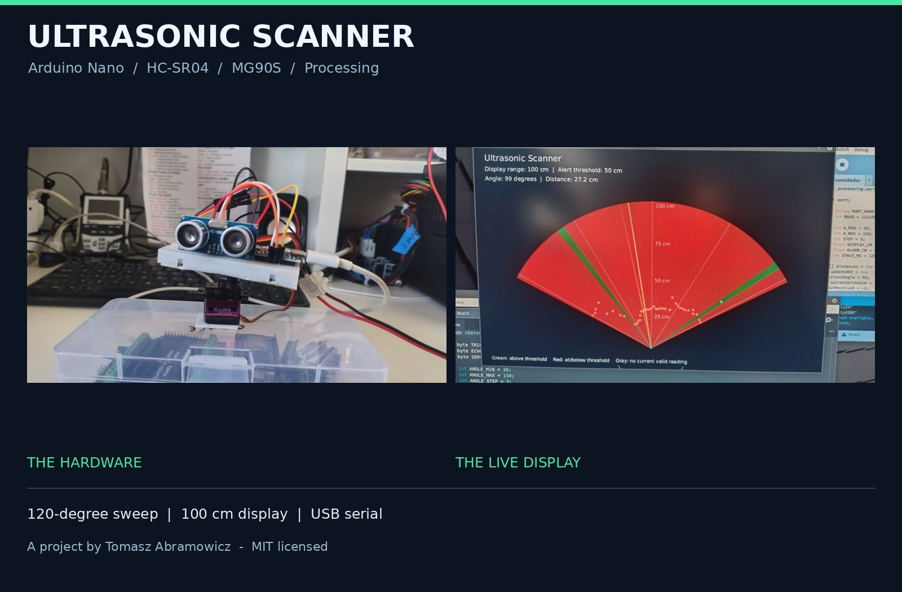
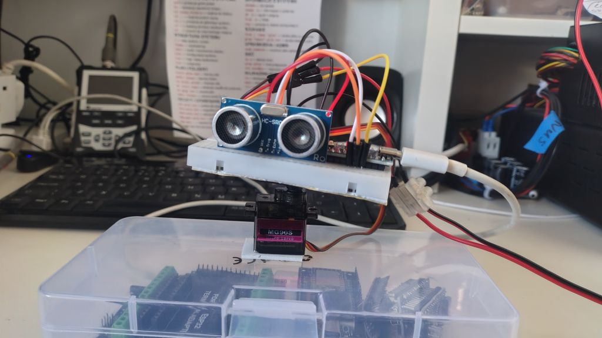
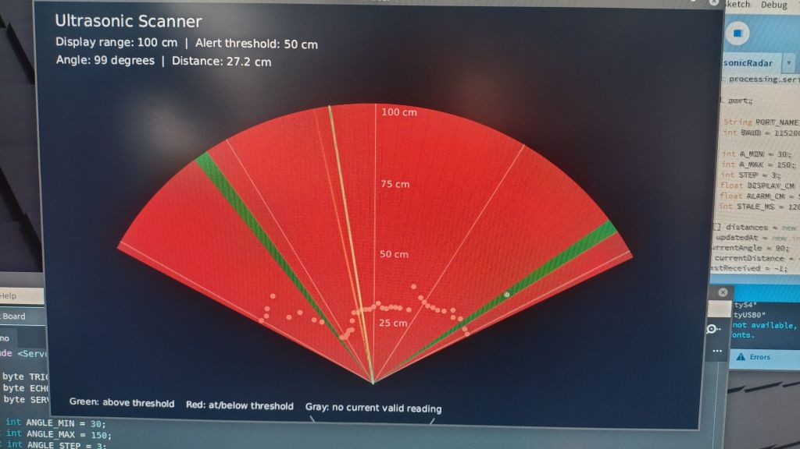
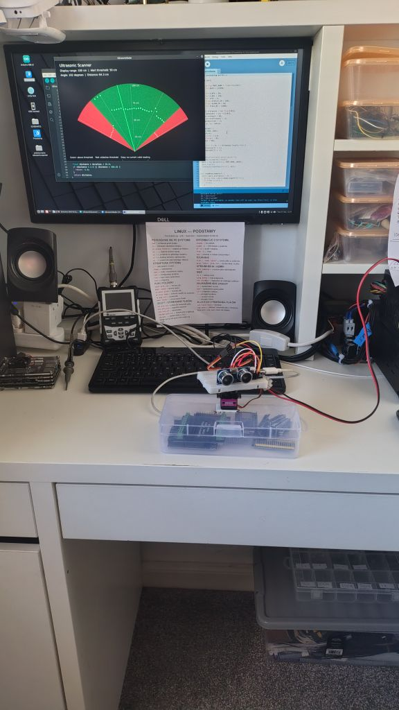
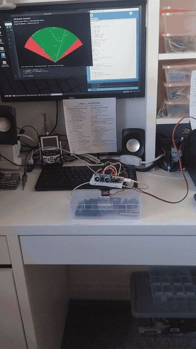
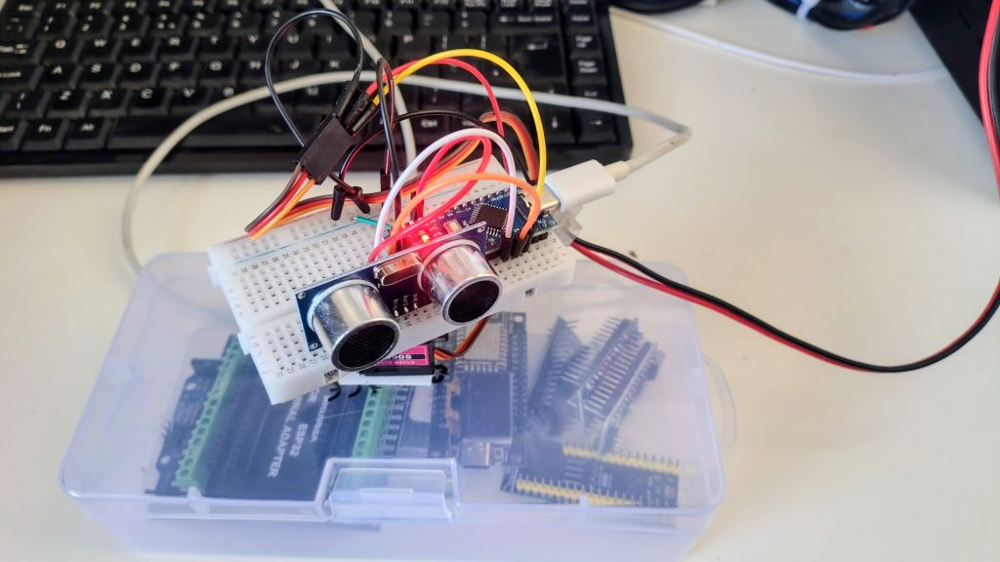
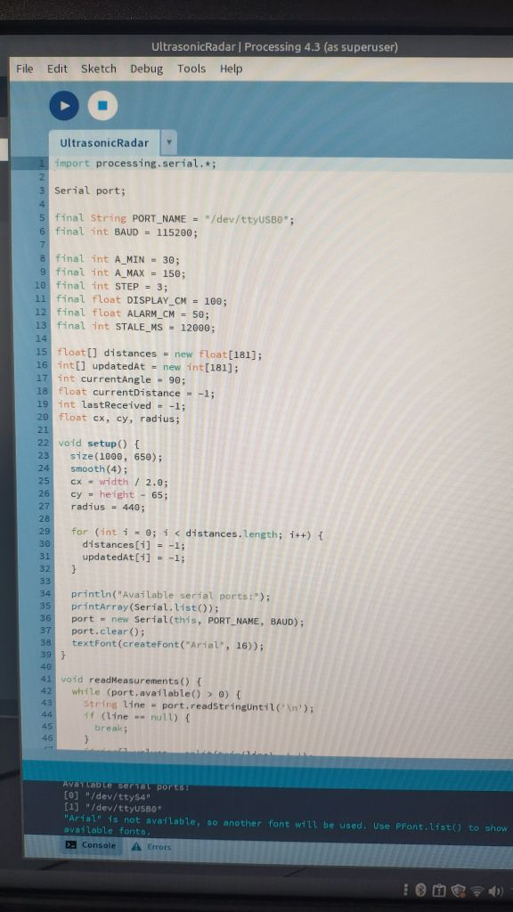
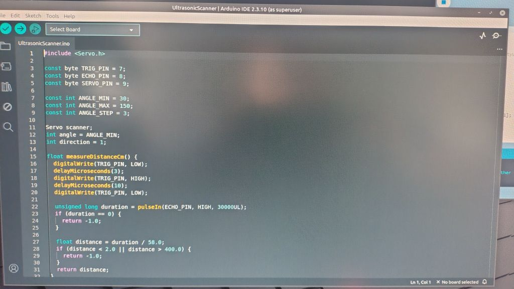

<div align="center">

# Arduino Nano Ultrasonic Scanner

### A small servo. A moving sensor. A live view of nearby obstacles.

**Built by Tomasz Abramowicz** · Arduino Nano · HC-SR04 · MG90S · Processing

[Overview](#overview) · [Hardware](#hardware) · [Quick start](#quick-start) · [Gallery](#gallery) · [License](#license)



</div>

## Overview

A hands-on ultrasonic scanning project that combines a rotating HC-SR04 sensor with an Arduino Nano and a radar-style desktop visualization. An MG90S servo sweeps the sensor across the scene while the Arduino sends angle and distance measurements to Processing over USB serial.

The result is a live, color-coded view of nearby objects, built from accessible components on a compact breadboard assembly.

> **Sonar, not radio radar:** the sensor uses ultrasound. The radar-style display is a way of presenting sequential distance measurements, not a precision map or a safety-rated detection system.

## At a glance

| Feature | Default setting |
|---|---|
| Controller | Arduino Nano V3.0 / ATmega328P, 5 V |
| Scan movement | Back and forth, 30°–150° |
| Scan increment | 3° |
| Visible distance | 100 cm |
| Alert threshold | 50 cm |
| USB serial speed | 115200 baud |
| Visualization | Processing, Java mode |
| Project license | MIT |

The builder reported the prototype working. The photographs document the physical assembly and running interface. This repository package has not been independently compiled or hardware-tested after preparation.

## How the display works

| Display element | Meaning |
|---|---|
| Red sector | A valid reading at or below the alert threshold |
| Green sector | A valid reading above the alert threshold |
| Gray sector | No current valid reading, including measurements older than 12 seconds |
| Point | Measured distance within the visible range |
| Sweep line | Latest commanded scan angle |

A sector describes its latest accepted reading, not every point within that area. Valid readings beyond the visible meter still produce green sectors, but no point is plotted outside the display. A missing echo is deliberately not shown as clear space.

## Hardware

| Component | Quantity | Purpose |
|---|---:|---|
| Arduino Nano V3.0, ATmega328P, 5 V | 1 | Measurement and servo control |
| HC-SR04 | 1 | Ultrasonic distance sensing |
| MG90S servo | 1 | Sensor rotation |
| External regulated 5 V supply | 1 | Servo power |
| USB data cable | 1 | Arduino power and serial communication |
| Breadboard and jumper wires | As needed | Connections |
| Lightweight bracket and stable base | 1 set | Mechanical mounting |

An Arduino UNO R3 can use the same sketch and pin assignments. These instructions are for classic 5 V boards, not all products in the Nano family.



## Wiring

| Component pin | Connect to |
|---|---|
| HC-SR04 VCC | Nano 5V |
| HC-SR04 GND | Nano GND |
| HC-SR04 TRIG | Nano D7 |
| HC-SR04 ECHO | Nano D8 |
| MG90S signal | Nano D9 |
| MG90S positive | External supply +5.0 V |
| MG90S ground | External supply negative |
| Nano GND | External supply negative |

> **Power arrangement:** power the Nano over USB and the servo from a separate 5.0 V supply. Connect the grounds together. Do not connect the external supply positive to the Nano 5V pin in this arrangement. Disconnect power before changing wiring.

See the [wiring and assembly guide](docs/WIRING.md) for the complete connection diagram and mechanical notes.

## Quick start

### 1. Upload the Arduino sketch

1. Open `arduino/UltrasonicScanner/UltrasonicScanner.ino` in Arduino IDE.
2. Install the `Servo` library if needed.
3. Select **Arduino AVR Boards → Arduino Nano**.
4. Select **ATmega328P** and the correct serial port.
5. Upload. If your Nano uses the older bootloader, select **ATmega328P (Old Bootloader)** and retry.
6. Open Serial Monitor at **115200 baud** to check for data.
7. Close Serial Monitor before starting Processing.

The servo is commanded to 90° for five seconds at startup, then begins scanning.

### 2. Start the desktop display

1. Open `processing/UltrasonicRadar/UltrasonicRadar.pde` in Processing.
2. Select **Java mode**.
3. Update the serial port setting if necessary:

```java
final String PORT_NAME = "/dev/ttyUSB0";
```

4. Click **Run** and wait for the first scan.

The default matches the Linux prototype. On Windows, use your actual COM port, for example `COM5`. Available ports are printed in the Processing console. Opening the serial connection may restart the board, so allow for the startup delay.

### 3. Check the result

Place a box approximately 25 cm in front of the sensor: detected sectors should turn red. Move it to around 70 cm: valid readings should turn green. Points should move to reflect the measured distance.



## Configuration

| Parameter | Program | Default | Purpose |
|---|---|---:|---|
| `ANGLE_MIN` / `ANGLE_MAX` | Arduino | 30 / 150 | Servo scan limits |
| `ANGLE_STEP` | Arduino | 3 | Scan increment |
| `A_MIN` / `A_MAX` | Processing | 30 / 150 | Displayed angle limits |
| `STEP` | Processing | 3 | Sector increment |
| `DISPLAY_CM` | Processing | 100 | Visible range |
| `ALARM_CM` | Processing | 50 | Alert threshold |
| `STALE_MS` | Processing | 12000 | Measurement lifetime |
| `PORT_NAME` | Processing | /dev/ttyUSB0 | Serial port |

Keep the angle limits and increments consistent between programs. Choose an increment that divides the scan span exactly. Increase `STALE_MS` if you significantly lengthen the scan cycle.

The grid labels are separately drawn at 25, 50, 75, and 100 cm. If you change the visible range, update the grid loop too. The sketch waits 90 ms after commanding each position; this is a settling delay, not a guarantee that every servo has reached its target.

## Serial protocol

Each measurement is a newline-terminated text record:

```text
angle,distance_cm
```

Example data, without a header:

```text
30,74.2
33,73.8
36,42.1
39,-1.0
```

`-1.0` means a timeout or a result rejected by the sketch. The angle is a commanded position, not measured shaft feedback. See [protocol notes](docs/PROTOCOL.md).

## Gallery

All seven supplied project photographs are included. The cover above combines two of those photographs into a presentation image.

<table>
<tr>
<td width="50%"><br>Complete workbench setup</td>
<td width="50%"><br>System in action</td>
</tr>
<tr>
<td><br>Servo-mounted sensor</td>
<td><br>Breadboard wiring</td>
</tr>
<tr>
<td><br>Processing sketch</td>
<td><br>Arduino sketch</td>
</tr>
</table>

The running visualization is shown in the larger image above. Photos are included as supplied; original image files have not been resized or recompressed. The composite cover is a separate image.

## Limitations and safe use

- This is an educational prototype, not a safety or security system.
- Scan directions are sampled sequentially, not simultaneously.
- A 3° servo increment does not imply 3° object-resolution accuracy.
- Sector color does not mean that the entire sector is occupied or clear.
- Missing or invalid echoes do not establish that a direction is unobstructed.
- Mounting, wires, and the USB cable must not obstruct the servo.
- Stop and disconnect servo power if the mechanism binds.

## Troubleshooting

See the [troubleshooting guide](docs/TROUBLESHOOTING.md) for serial-port, power, measurement, and font-message checks.

## Repository layout

```text
.
├── README.md
├── LICENSE
├── NOTICE.md
├── CHANGELOG.md
├── CONTRIBUTING.md
├── .gitignore
├── .gitattributes
├── arduino/
│   └── UltrasonicScanner/
│       └── UltrasonicScanner.ino
├── processing/
│   └── UltrasonicRadar/
│       └── UltrasonicRadar.pde
└── docs/
    ├── WIRING.md
    ├── PROTOCOL.md
    ├── TROUBLESHOOTING.md
    ├── PUBLISHING.md
    └── images/
```

## Author

Created and built by **Tomasz Abramowicz**.

Copyright (c) 2026 Tomasz Abramowicz.

## License

This project is released under the [MIT License](LICENSE).

You may use, copy, modify, share, and sell the software, including in commercial projects, provided the copyright and permission notices are retained as required by the license. The project is provided **as is**, without warranty.

The project's original code, documentation, and contributed project photographs are shared under the repository license. Third-party libraries, applications, brands, and other material visible in photographs retain their respective rights; see [NOTICE.md](NOTICE.md).
